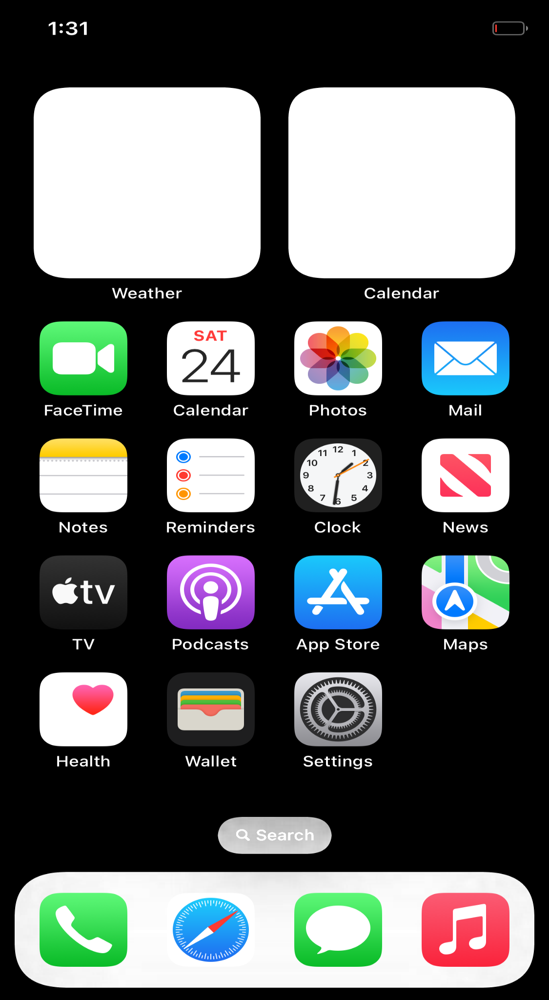
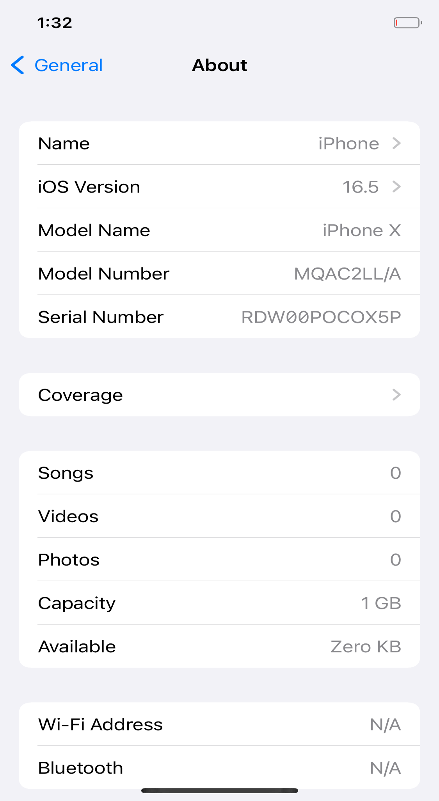
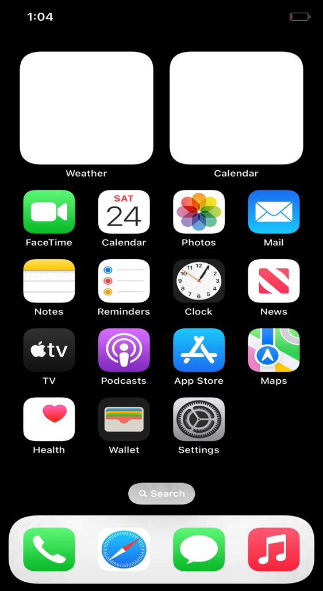

# HackiOS · Raphael & QEMU

面向 Redmi K20 Pro（代号 **raphael**，Qualcomm SM8150）与 QEMU ARM64 的系统适配研究。

本项目基于 [OOSEX GANG 的 HackiOS](https://github.com/oosexgang/hackios-xnu-kernel)，提供 XNU 驱动扩展、固定版本补丁、测试工具和验证记录，研究非 Apple ARM64 平台上的内核启动、设备接入与图形显示路径。

目前已在 QEMU 中运行 iOS 16.5 用户态，进入 SpringBoard 桌面并操作系统设置；新增 VirtIO-GPU 驱动已完成 2D 显示链路验证。Redmi K20 Pro 相关代码处于实验性适配阶段，尚未经过真机验证。**当前图形合成仍采用 CPU 软件渲染，未实现 Metal 或桌面硬件加速。**

最新 v0.2 新增显式启用的 **virgl v1 传输测试**：已在 llvmpipe 宿主上完成上下文创建、3D 资源、命令提交及两轮全像素读回验证。该路径尚未接入应用图形 API，详见[virgl 实验说明](experimental/virgl/README.md)。

## 功能与验证状态

| 组件 | 当前实现 | 验证范围 |
|---|---|---|
| QEMU VirtIO-GPU | 现代 virtio-mmio、2D 资源、后备内存注册、传输与扫描输出 | QEMU 实际运行，1125 × 2048 输出 |
| iOS 用户态 | SpringBoard、触摸输入及设置页面交互 | 桌面 → 设置 → 通用 → 关于本机 |
| Adreno 640 | 固件解析、时钟控制与恢复、GMU/SMMU 分阶段探测 | 主机模型测试与 ARM64 编译；未真机验证 |
| Goodix GT9886 | GPIO I2C 通信、触摸报告校验与坐标转换 | 主机模型测试与 ARM64 编译；未真机验证 |
| UFS 存储 | 只读策略及已有 UEFI 存储路径复用 | 策略测试；未实现原生冷初始化及 UFS 根文件系统启动 |
| virgl v1 传输 | 显式启用的上下文、3D资源、清屏提交与读回测试 | llvmpipe宿主实测，两轮各4096像素校验通过 |
| 应用 3D / Metal | 用户态图形API与桌面合成接入待实现 | 未实现硬件加速 |

VirtIO-GPU 运行记录确认至少完成 **240 次帧传输**，对应完成标记 `fence 488`。该指标是累计完成次数，不是帧率，不构成性能提升结论。

## 实测截图

以下截图通过 QMP 显式指定 `device=vgpu, head=0` 获取，展示新增 VirtIO-GPU 2D 驱动的实际输出。

| SpringBoard 桌面 | 设置 · 关于本机 |
|:---:|:---:|
|  |  |

截图中的设备型号、序列号与容量由兼容配置及当前文件系统实现提供，不能用作 Redmi K20 Pro 硬件信息或存储容量的验证依据。

## 启动过程录屏

[](docs/video/ios165-boot-and-settings.mp4)

**[查看或下载启动录屏 · MP4](docs/video/ios165-boot-and-settings.mp4)**

视频记录了 QEMU 开机、系统初始化、桌面及设置页面操作，总长约 **7 分 30 秒**；采用 H.264 编码，分辨率 562 × 1024，以 3 帧/秒采集，保留原速等待过程。

| 时间位置 | 内容 |
|---|---|
| 00:00–05:11 | 固件启动、苹果标志与系统初始化 |
| 05:11–05:15 | 录制连接切换的间隔提示 |
| 05:15 | 桌面展示 |
| 05:23 | 打开设置 |
| 06:40 | 进入通用 |
| 07:00 | 进入关于本机 |

该视频来自**此前的 ramfb 显示会话**，用于记录系统启动过程；上方截图来自后续 VirtIO-GPU 会话。两者均为 QEMU 实测记录，不作为手机真机启动、GPU 加速或帧率测试的证据。录制间隔及采集方式见[录屏说明](docs/video/RECORDING.md)。

## 实现概览

- **VirtIO-GPU 显示路径**：建立控制队列，创建 2D 资源，注册 framebuffer 的物理后备内存，并提交 `TRANSFER_TO_HOST_2D`、`RESOURCE_FLUSH` 与 `SET_SCANOUT` 请求；校验响应类型、长度和 fence，处理超时及设备重置。
- **内存共享**：通过真实物理地址构建 scatter/gather 列表，支持非连续页与连续区间合并，复用现有 framebuffer，避免额外的 guest 整屏像素复制。
- **设备适配**：为 SM8150 单独提供实验代码及启动参数，区分手机寄存器路径与 QEMU 虚拟设备路径。
- **验证工具**：覆盖固件边界检查、触摸协议、I2C 时序、时钟恢复、VirtIO 响应及 UFS 访问策略。

## 源码与构建

### 准备固定版本工作区

需要 Git 与 Python 3.12+。在本仓库目录执行：

```sh
python3 scripts/prepare.py work/hackios
```

脚本获取以下开源上游的固定提交，应用补丁并复制驱动文件：

| 上游 | 固定提交 |
|---|---|
| [hackios-xnu-kernel](https://github.com/oosexgang/hackios-xnu-kernel) | `d82c64a3a31cd27a0a0afbf6e213e467e44b1b4c` |
| [hackios-xnu-userland](https://github.com/oosexgang/hackios-xnu-userland) | `a79ff0772a3454fd1ef127e181e5b3bce6c9ce18` |

目标目录必须不存在。脚本仅准备源码，不安装编译工具链，也不下载 SDK、手机固件或系统镜像。随后按[上游文档](https://github.com/oosexgang/hackios-xnu-kernel)准备构建依赖，运行 `xnu/apply.sh` 创建 XNU 树，再进行编译。构建前建议使用 `umask 022`，确保镜像中的公共目录具有适当的访问权限。

本次云端构建完成了 ARM64 内核编译与链接，未解析符号数为零；完整 `make` 仍因既有 DriverKit 导出及 symbolset 检查失败而返回退出码 2。工具链环境与验证边界见[实测报告](evidence/RESULTS.md)。

### 运行主机测试

```sh
bash scripts/test-host.sh
```

测试使用 GCC 与 ASan/UBSan，覆盖 GT9886、I2C、A640、VirtIO-GPU（含virgl命令编码）及 UFS 策略；另以原生测试检查软件EGL适配器的错误处理。GitHub Actions 中配置了相同的测试任务。主机测试结果不替代真机验证；CI 不启动 iOS，也不验证 3D 加速。

### 启动 QEMU

在内核、loader 与用户态镜像已构建完成后执行：

```sh
bash scripts/run-qemu.sh work/hackios 900
python3 scripts/screenshot.py virtio-screen.png
```

运行环境需要支持 `virtio-gpu-device` 的 QEMU 与 AArch64 UEFI。Debian 的默认固件路径为 `/usr/share/AAVMF/`；其他安装位置可通过 `QEMU_EFI`、`QEMU_VARS` 指定，非系统安装还可设置 `QEMU_MODULE_DIR`、`QEMU_DATA_DIR`。

启动脚本默认启用 `virtio_gpu=1` 并添加 `-device virtio-gpu-device,id=vgpu,xres=1125,yres=2048`，保留 ramfb 用于 loader。纯 QEMU 运行应使用虚拟输入路径，不设置 `raphael=1`。QMP 默认使用本机 4445 端口，同一时刻仅允许一个客户端连接。

需要测试虚拟3D传输时，请按[virgl实验配置](experimental/virgl/README.md)显式启用。默认2D配置保持不变；GL后端的截图限制与ramfb镜像采集方式也在该文档中说明。

## 项目结构

| 路径 | 内容 |
|---|---|
| `overlay/` | 新增驱动及头文件，沿用上游源码目录结构 |
| `patches/` | 内核接入与用户态修复补丁 |
| `scripts/` | 源码准备、主机测试、QEMU 启动与截图工具 |
| `tests/` | 协议、固件、内存及访问策略测试 |
| `evidence/` | 实测日志、环境记录与验证报告 |
| `experimental/virgl/` | virgl传输说明与显式启用的宿主软件EGL测试适配器 |
| `docs/` | 屏幕截图、启动录屏及采集说明 |
| `downloads/` | 实验内核、源码与日志归档 |
| `upstream.json` | 上游仓库及固定提交信息 |

编译包的 SHA-256 校验值见 [`SHA256SUMS`](SHA256SUMS)。归档中的内核是研究用构建产物，不是可直接刷入手机的 `boot.img`。

## 已知限制与后续工作

- **图形加速**：CoreAnimation 目前使用软件渲染。当前云环境未暴露物理 GPU；v0.2 已补齐 QEMU GL 模块并通过 llvmpipe 进行基础 virgl 传输验证，后续仍需用户态图形 API、着色器/绘制和桌面合成接入。
- **手机平台**：需先验证 loader、供电和寄存器访问，再推进 GMU 地址空间、固件启动、GX 供电与 CP/SQE 命令执行。
- **存储启动**：原生 UFS 冷初始化、块设备接入及从 UFS 挂载根文件系统的启动链尚未完成。

## 来源与许可

本项目保留 [OOSEX GANG](https://github.com/oosexgang) 上游作者归属及原有许可。内核相关代码及修改遵循 APSL-2.0，用户态上游 MIT 许可见 [`licenses/USERLAND-MIT.txt`](licenses/USERLAND-MIT.txt)，其他来源见 [`NOTICE.md`](NOTICE.md)。

仓库不包含 iOS 镜像、Apple SDK 或 Qualcomm 固件。编译产物来自开源 XNU 及本项目补丁。本项目为独立研究项目，与 Apple Inc. 无隶属关系，亦未获得其认可或背书。
